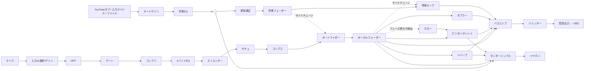

# UTAWAKU LIVE — 歌枠ライブミキサー

YouTube の歌枠を「歌ってみた音源を聴いているような」品質で配信するためのライブ用ミキサーです。配信用 DAW の代わりに使えます。
**伴奏を事前に DAW へ取り込む必要はありません。** YouTube のカラオケ動画を開いているタブの音を、そのまま取り込んで歌と一緒に処理します。

| | デスクトップ版 `native/`（推奨） | ブラウザ版（お試し） |
| --- | --- | --- |
| **VST3 / AU プラグイン** | ✅ ボーカル・AUX(リバーブ/ディレイ)・伴奏・マスターに各6スロット | ❌（ブラウザの制約で不可） |
| オーディオドライバ | ASIO / WASAPI / CoreAudio（低レイテンシ） | ブラウザ経由（20〜50ms） |
| YouTube タブの取り込み | ブラウザ連携ページ経由（下記） | 直接 |
| 配信出力 | インターフェースの出力ch または仮想デバイス | 仮想デバイス |
| 内蔵の処理・自動化・シーン | 同じ | 同じ |

## デスクトップ版（VST 対応）

### 入手・ビルド
GitHub Actions（`.github/workflows/utawaku-native.yml`）が Windows / macOS / Linux 向けにビルドし、テスト（DSP・実際の VST3 の読み込み・エンジン）を通した実行ファイルを Artifacts に置きます。

手元でビルドする場合（CMake 3.22 以上と C++17 コンパイラ。JUCE 8 は自動で取得）：

```bash
cd native
cmake -S . -B build                       # Windows で ASIO を使う場合は -DUL_ASIO_SDK=<ASIO SDK のパス>
cmake --build build --config Release
ctest --test-dir build -C Release         # DSP / VST3 ホスティング / エンジンのテスト
```

### VST の使い方
1. 「プラグイン管理」→「オプション」→「スキャン」で VST3 フォルダ（Windows: `C:\Program Files\Common Files\VST3`、Mac: `/Library/Audio/Plug-Ins/VST3`）を検出（Mac は AU も可）
2. 各セクションの「＋ VST を追加」から挿す。右の「編集」でプラグインの画面、スイッチでバイパス
3. 挿せる場所
   - **ボーカル・インサート**：内蔵チェーン（ゲート→コンプ→EQ→ディエッサー→サチュ→コンプ）の後。歌ってみたの MIX で使っている自分のプラグインチェーンをそのまま再現できます。内蔵モジュールは個別に「使用」をオフにできます
   - **AUX A / AUX B**：センド・リターンのリバーブ / ディレイ。「内蔵リバーブ（ディレイ）を使う」をオフにすると、送り信号がそのまま VST に入ります（VST 側は Mix 100% に）。オート・スローも AUX B 経由で効きます
   - **伴奏インサート**：キー変更（ピッチシフター）や伴奏用 EQ など
   - **マスター・インサート**：バスコンプの前。最後段は内蔵リミッターでシーリングを保証
4. **レイテンシ補正**：ボーカル側の VST のレイテンシは自動で検出し、配信側の伴奏をその分遅らせて歌と揃えます。レイテンシの大きいプラグインを挿したときは、モニターの「自分の声の取り出し位置」を「VSTの前」にすると歌いやすくなります
5. プラグインの状態とバイパスは自動保存され、バイパスはシーンにも記録されます（例：サビだけ別の VST を有効に）。「プリセット」で VST の設定ごと書き出し / 読み込みできます

### YouTube タブの伴奏を取り込む（ブラウザ連携）
アプリは起動すると `http://localhost:5181/` で連携ページを開きます。伴奏ソースを「ブラウザ連携」にして「連携ページを開く」→ Chrome/Edge で「YouTube タブを取り込む」→ カラオケ動画のタブを選び「タブの音声も共有する」をオン。
タブの音はローカル接続（WebSocket）でアプリに送られ、タブ側のスピーカー再生は止まります。ブラウザとオーディオインターフェースのクロック差は自動で補正（可変レート再サンプリング）するので、長時間の配信でもズレや途切れが溜まりません。

ほかの伴奏ソース：インターフェースのループバック入力ch / 別のオーディオデバイス（仮想ケーブル等）/ 音声ファイル。

### 配信出力
- **インターフェースの別の出力ch**（3-4 など）を OBS で取り込む、または
- **別デバイス**（VB-CABLE / BlackHole など）を選ぶ → OBS の音声入力キャプチャでそのデバイスを追加

モニター（イヤホン）とは別のミックスが配信に出ます。録音ボタンで配信ミックスを 24bit WAV で保存できます（`ミュージック/UTAWAKU LIVE`）。

### 操作
| 操作 | キー / MIDI |
| --- | --- |
| シーン呼び出し | 1〜6 / プログラムチェンジ 0〜5 / ノート 36〜41 |
| 現在値をシーンに保存 | Shift + 1〜6（Shift+クリック）。右クリックで名前変更 |
| 手動スロー（押している間） | D / CC64（サステインペダル = フットスイッチ） |
| タップテンポ | T |
| パニック | Esc |

## ブラウザ版（お試し・VST なし）

```
npm start        # http://localhost:5180 を Chrome / Edge で開く（依存パッケージなし）
npm test         # DSP のユニットテスト（node --test）
```

## 考え方：「歌ってみたのMIX」を「ライブPAのやり方」で再現する

歌ってみたの MIX でやっている作業は、録音後にオートメーションやプラグインで少しずつ仕上げていくものです。
生配信ではやり直しがきかないので、**生ライブの PA がその場でやっていること**に置き換えて、手動の部分を自動化しています。

| 歌ってみたのMIXでやること | ライブPAでのやり方 | このアプリでの実装 |
| --- | --- | --- |
| ボーカルの音量オートメーションを描く | フェーダーを手で上げ下げする | **オートライダー**：伴奏の中域レベルを基準に、ボーカルのゲインを ±6dB の範囲で自動的に上げ下げ |
| 伴奏の帯域を削ってボーカルの居場所を作る | 歌が入っている間だけ伴奏を EQ で引っ込める | **ボーカル帯域カーブ**：歌っている間だけ伴奏の 2.5kHz 付近を数dB下げるダイナミックEQ（Trackspacer 方式） |
| 語尾だけにディレイを送るオートメーション | エンジニアがフレーズ終わりでセンドを上げる「ディレイ・スロー」 | **オート・スロー**：フレーズ終わりを検出し、最後の語尾だけをディレイ（とリバーブ）へ送る。D キー / フットスイッチで手動スローも可能 |
| セクションごとにプラグインの設定を変える | 曲・セクションごとにシーン（スナップショット）を切り替える | **シーン 1〜6**：キー・MIDI で呼び出し、設定したクロスフェード時間でなめらかに移行 |
| 伴奏ファイルの音量をそろえる | サウンドチェックで卓のゲインを合わせる | **伴奏オートゲイン**：動画ごとにバラバラな音量を K特性ラウドネスで目標値へゆっくり合わせる（固定も可能） |
| 2段コンプ・ディエッサー・サチュレーション | チャンネルストリップ | ゲート → コンプ①(ピーク) → EQ → ディエッサー → サチュレーション → コンプ②(レベリング) |
| マスタリング | — | バスコンプ → 先読みリミッター（シーリング保証）→ ラウドネスメーター（M/S/I, EBU R128） |
| イヤモニ | ステージ上のモニターミックス | **配信ミックスとは別のモニターミックス**（自分の声多め・リバーブ多めなど）。耳保護のソフトクリップ付き |

## 信号の流れ



### 遅延補正が必要な理由

歌い手はイヤホンで（出力レイテンシ分遅れた）伴奏を聴いて、それに合わせて歌います。その声はさらに入力レイテンシ分遅れてミキサーに届くので、
そのまま混ぜると配信では **声が伴奏より 往復レイテンシ分（数十ms）遅れて** 聞こえます。DAW のレイテンシ補正と同じく、配信側の伴奏だけをその分遅らせて揃えます
（モニター側の伴奏は遅らせないので歌いにくくなりません）。「自動推定」はブラウザが報告する値を使うので、一度録音して微調整してください。

## ブラウザ版のセットアップ

### 必要なもの
- PC 版 Chrome または Edge（タブ音声のキャプチャ・出力先の指定・AudioWorklet を使用）
- 仮想オーディオデバイス：Windows は VB-CABLE、Mac は BlackHole など
- オーディオインターフェース（推奨。ドライバのバッファは 128 サンプル以下に）

### 手順
1. `npm start` → `http://localhost:5180` を開いて「エンジン起動」
2. マイクを選び、インターフェースの IN1/IN2 どちらにマイクが挿さっているかを「入力チャンネル」で合わせる
   - ブラウザ標準のエコーキャンセル・ノイズ抑制・自動ゲインはすべて切っています（歌の音質を大きく損なうため）
3. YouTube のカラオケ動画を**別のタブ**で開き、「YouTubeタブを取り込む」→ そのタブを選んで「タブの音声も共有する」をオン
   - タブ側のスピーカー再生は自動で止まり、このミキサー経由でのみ聞こえます
   - **「画面全体」＋システム音声は選ばないでください**（ミキサー自身の出力を拾ってハウリングします）
4. モニター出力にイヤホン（インターフェースの出力）、配信出力に仮想デバイスを選ぶ
5. OBS：音声入力キャプチャで仮想デバイスを追加し、デスクトップ音声とマイクは OBS 側でミュート
6. 遅延補正 →「自動推定」。録音ボタンで録って、声と伴奏が揃っているか確認
7. 入力ゲインはインターフェース側で決め、マスターの Integrated が -16〜-14 LUFS 付近になるように「リミッターへの入力」で調整

インターフェースのダイレクトモニタリングを使う場合は、モニターの「自分の声」を OFF（-60）にしてください。

### 操作
| 操作 | キー / MIDI |
| --- | --- |
| シーン呼び出し | 1〜6 / プログラムチェンジ 0〜5 / ノート 36〜41 |
| 現在値をシーンに保存 | Shift + 1〜6（Shift+クリックでも可） |
| 手動スロー（押している間） | D / CC64（サステインペダル = フットスイッチ） |
| タップテンポ（ディレイ同期） | T |
| パニック（配信・モニターを即ミュート） | Esc |

設定とシーンはブラウザに自動保存され、JSON で書き出し／読み込みできます。

## 構成

```
native/                    デスクトップ版（JUCE 8 / C++17）
  Source/dsp/Dsp.h           DSP コア（ブラウザ版と同じアルゴリズムを C++ に移植、JUCE 非依存）
  Source/MixerEngine.*       オーディオコールバック：全チャンネル処理・VST チェーン・遅延補正・録音
  Source/PluginChain.*       VST3/AU インサート（ロック付き差し替え・バイパス・レイテンシ集計・状態保存）
  Source/PluginHost.*        スキャン・非同期ロード・エディタウィンドウ・復元
  Source/ClockBridge.h       別クロック音声の受け渡し（FIFO＋PI制御の可変レート再サンプリング）
  Source/BrowserBridge.*     連携ページの HTTP / WebSocket サーバー（localhost のみ）
  Source/SecondaryDevice.h   2台目のオーディオデバイス（伴奏入力 / 配信出力）
  Source/ui/*                GUI（パラメータ表から自動生成）
  Tests/                     DSP テスト、テスト用 VST3、VST3 を実際に読み込むエンジンテスト
```

ブラウザ版：

```
index.html, styles.css
server.mjs                 依存ゼロの静的サーバー（AudioWorklet/マイクには localhost が必要）
src/main.js                UI（パラメータ表から自動生成）・キー/MIDI・メーター
src/engine.js              Web Audio グラフ（ネイティブ EQ/ディレイ/コンボリューション + 自作 Worklet）
src/params.js              全パラメータとシーンのプリセット
src/worklets/processors.js AudioWorklet ラッパー
src/dsp/*.js               DSP 本体（純粋関数・クラス。Node でテスト）
  dynamics.js   ソフトニー・コンプ、エキスパンダー、ダイナミックシェルフ型ディエッサー、ADAA tanh サチュレーター
  limiter.js    先読みリミッター（ホールド最小値 + 移動平均でシーリングを数学的に保証）
  loudness.js   BS.1770 K特性ラウドネス（Momentary / Short-term / ゲート付き Integrated）
  live.js       オートライダー、フレーズ終わり検出、帯域カーブ、伴奏オートゲイン
  reverb.js     プレート/ホール/ルーム/チェンバーの IR 生成
```

## 既知の制約と今後

- キー変更・ピッチ補正は内蔵していません。デスクトップ版では伴奏インサート / ボーカル・インサートに VST（ピッチシフター、Auto-Tune 等）を挿して使ってください。
- デスクトップ版のブラウザ連携は約 40ms のバッファを持ちます（伴奏が遅れるだけで、歌との相対タイミングには影響しません）。
- Windows の ASIO は Steinberg の ASIO SDK を用意してビルドする必要があります（ライセンスの都合で同梱していません）。CI のビルドは WASAPI（排他/共有）と DirectSound に対応します。
- ブラウザ版は往復レイテンシが 20〜50ms 程度になり、配信出力は `<audio>.setSinkId` 経由なので配信ミックス全体が数十ms遅れます（OBS の「同期オフセット」で調整）。
- YouTube の音源を配信で使う場合は、各動画・楽曲の利用規約と権利処理（YouTube の楽曲利用許諾など）を確認してください。
