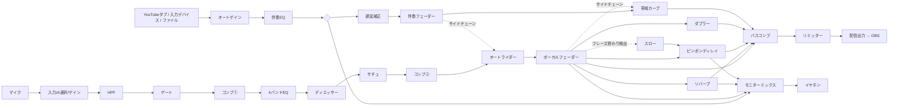

# UTAWAKU LIVE — 歌枠ライブミキサー

YouTube の歌枠を「歌ってみた音源を聴いているような」品質で配信するための、ブラウザで動くライブ用ミキサーです。
配信用 DAW の代わりに使えます。**伴奏を事前に DAW へ取り込む必要はありません。** YouTube のカラオケ動画を開いているタブの音を、そのまま取り込んで歌と一緒に処理します。

```
npm start        # http://localhost:5180 を Chrome / Edge で開く（依存パッケージなし）
npm test         # DSP のユニットテスト（node --test）
```

## 考え方：「歌ってみたのMIX」を「ライブPAのやり方」で再現する

歌ってみたの MIX でやっている作業は、録音後にオートメーションやプラグインで少しずつ仕上げていくものです。
生配信ではやり直しがきかないので、**生ライブの PA がその場でやっていること**に置き換えて、手動の部分を自動化しています。

| 歌ってみたのMIXでやること | ライブPAでのやり方 | このアプリでの実装 |
| --- | --- | --- |
| ボーカルの音量オートメーションを描く | フェーダーを手で上げ下げする | **オートライダー**：伴奏の中域レベルを基準に、ボーカルのゲインを ±6dB の範囲で自動的に上げ下げ |
| 伴奏の帯域を削ってボーカルの居場所を作る | 歌が入っている間だけ伴奏を EQ で引っ込める | **ボーカル帯域カーブ**：歌っている間だけ伴奏の 2.5kHz 付近を数dB下げるダイナミックEQ（Trackspacer 方式） |
| 語尾だけにディレイを送るオートメーション | エンジニアがフレーズ終わりでセンドを上げる「ディレイ・スロー」 | **オート・スロー**：フレーズ終わりを検出し、最後の語尾だけをディレイ（とリバーブ）へ送る。D キー / フットスイッチで手動スローも可能 |
| セクションごとにプラグインの設定を変える | 曲・セクションごとにシーン（スナップショット）を切り替える | **シーン 1〜6**：キー・MIDI で呼び出し、設定したクロスフェード時間でなめらかに移行 |
| 伴奏ファイルの音量をそろえる | サウンドチェックで卓のゲインを合わせる | **伴奏オートゲイン**：動画ごとにバラバラな音量を K特性ラウドネスで目標値へゆっくり合わせる（固定も可能） |
| 2段コンプ・ディエッサー・サチュレーション | チャンネルストリップ | ゲート → コンプ①(ピーク) → EQ → ディエッサー → サチュレーション → コンプ②(レベリング) |
| マスタリング | — | バスコンプ → 先読みリミッター（シーリング保証）→ ラウドネスメーター（M/S/I, EBU R128） |
| イヤモニ | ステージ上のモニターミックス | **配信ミックスとは別のモニターミックス**（自分の声多め・リバーブ多めなど）。耳保護のソフトクリップ付き |

## 信号の流れ



### 遅延補正が必要な理由

歌い手はイヤホンで（出力レイテンシ分遅れた）伴奏を聴いて、それに合わせて歌います。その声はさらに入力レイテンシ分遅れてミキサーに届くので、
そのまま混ぜると配信では **声が伴奏より 往復レイテンシ分（数十ms）遅れて** 聞こえます。DAW のレイテンシ補正と同じく、配信側の伴奏だけをその分遅らせて揃えます
（モニター側の伴奏は遅らせないので歌いにくくなりません）。「自動推定」はブラウザが報告する値を使うので、一度録音して微調整してください。

## セットアップ

### 必要なもの
- PC 版 Chrome または Edge（タブ音声のキャプチャ・出力先の指定・AudioWorklet を使用）
- 仮想オーディオデバイス：Windows は VB-CABLE、Mac は BlackHole など
- オーディオインターフェース（推奨。ドライバのバッファは 128 サンプル以下に）

### 手順
1. `npm start` → `http://localhost:5180` を開いて「エンジン起動」
2. マイクを選び、インターフェースの IN1/IN2 どちらにマイクが挿さっているかを「入力チャンネル」で合わせる
   - ブラウザ標準のエコーキャンセル・ノイズ抑制・自動ゲインはすべて切っています（歌の音質を大きく損なうため）
3. YouTube のカラオケ動画を**別のタブ**で開き、「YouTubeタブを取り込む」→ そのタブを選んで「タブの音声も共有する」をオン
   - タブ側のスピーカー再生は自動で止まり、このミキサー経由でのみ聞こえます
   - **「画面全体」＋システム音声は選ばないでください**（ミキサー自身の出力を拾ってハウリングします）
4. モニター出力にイヤホン（インターフェースの出力）、配信出力に仮想デバイスを選ぶ
5. OBS：音声入力キャプチャで仮想デバイスを追加し、デスクトップ音声とマイクは OBS 側でミュート
6. 遅延補正 →「自動推定」。録音ボタンで録って、声と伴奏が揃っているか確認
7. 入力ゲインはインターフェース側で決め、マスターの Integrated が -16〜-14 LUFS 付近になるように「リミッターへの入力」で調整

インターフェースのダイレクトモニタリングを使う場合は、モニターの「自分の声」を OFF（-60）にしてください。

### 操作
| 操作 | キー / MIDI |
| --- | --- |
| シーン呼び出し | 1〜6 / プログラムチェンジ 0〜5 / ノート 36〜41 |
| 現在値をシーンに保存 | Shift + 1〜6（Shift+クリックでも可） |
| 手動スロー（押している間） | D / CC64（サステインペダル = フットスイッチ） |
| タップテンポ（ディレイ同期） | T |
| パニック（配信・モニターを即ミュート） | Esc |

設定とシーンはブラウザに自動保存され、JSON で書き出し／読み込みできます。

## 構成

```
index.html, styles.css
server.mjs                 依存ゼロの静的サーバー（AudioWorklet/マイクには localhost が必要）
src/main.js                UI（パラメータ表から自動生成）・キー/MIDI・メーター
src/engine.js              Web Audio グラフ（ネイティブ EQ/ディレイ/コンボリューション + 自作 Worklet）
src/params.js              全パラメータとシーンのプリセット
src/worklets/processors.js AudioWorklet ラッパー
src/dsp/*.js               DSP 本体（純粋関数・クラス。Node でテスト）
  dynamics.js   ソフトニー・コンプ、エキスパンダー、ダイナミックシェルフ型ディエッサー、ADAA tanh サチュレーター
  limiter.js    先読みリミッター（ホールド最小値 + 移動平均でシーリングを数学的に保証）
  loudness.js   BS.1770 K特性ラウドネス（Momentary / Short-term / ゲート付き Integrated）
  live.js       オートライダー、フレーズ終わり検出、帯域カーブ、伴奏オートゲイン
  reverb.js     プレート/ホール/ルーム/チェンバーの IR 生成
```

## 既知の制約と今後

- **キー変更（ピッチシフト）は未実装**。リアルタイムで高音質なものは位相ボコーダー等が必要なので、次の候補です（当面は YouTube 側のキー違い音源を使ってください）。
- ピッチ補正（オートチューン）、VST/AU プラグインのホストは未対応。どうしても必要ならネイティブ版（JUCE 等）への移植が必要です。
- ブラウザ経由のため、往復レイテンシは環境次第で 20〜50ms 程度になります。気になる場合は声だけインターフェースのダイレクトモニタリングにし、リバーブだけモニターに返す運用がおすすめです。
- 配信出力（仮想デバイス）は `<audio>.setSinkId` 経由なので、配信ミックス全体が数十ms遅れます。映像とのズレは OBS の「同期オフセット」で合わせてください。
- YouTube の音源を配信で使う場合は、各動画・楽曲の利用規約と権利処理（YouTube の楽曲利用許諾など）を確認してください。
